<!-- Elegant Typing Intro -->

  

  

---

### 👨‍💻 About Me

I’m an **AI Full Stack Developer** with a strong focus on **Computer Vision and OCR systems**, passionate about building **intelligent, scalable and production-grade applications**.  
I focus on **reliability, performance and clean architecture**, leveraging **AWS**, **FastAPI**, **Django**, **React/Next.js**, **React Native** and **Flutter** to deliver production-grade solutions.

- ⚡ Design & deploy **scalable AI systems** on AWS (Lambda, ECS, EC2, S3, RDS)
- 🧩 Skilled in **FastAPI, Django, Flask** and **microservice architectures**
- 💻 Build **modern web applications** with **React, Next.js** and **TypeScript**
- 📱 Develop **cross-platform mobile apps** using **React Native** and **Flutter**
- 🤖 Specialized in **Generative AI**, **Computer Vision**, **LLMs** and **real-time streaming** integrations
- 🧰 Passionate about **clean architecture**, automation and system reliability
- 📬 **Contact:** shinystar307@gmail.com
- ☎️ **Whatsapp:** +1 (856) 490-3088

> 🧠 "Code isn't just logic - it's architecture, design and innovation combined."

---

## GitHub Stats

<!-- Row 1: Streak Stats & Commit Activity -->
<table border="0" cellspacing="0" cellpadding="5">
  <tr>
    <td align="center" width="50%">
      
    </td>
   
  </tr>
</table>

---

## 💻 Spent My Time

  

---

### 🛠️ Tech Stack

#### 💾 Backend & Cloud

  

#### 🧰 Frontend & Mobile

  

#### ☁️ Cloud & DevOps

  

---

  <i>🚀 Crafting backends, web & mobile apps that scale, clouds that perform and solutions that inspire.</i>

---

## What I'm Looking For

I'm actively looking for **Data Visualization**, **Data Analysis**, **Machine Learning** and **AI/ML Engineering Internship** opportunities where I can contribute to real-world systems, learn from experienced engineers, and build scalable products.

**If you'd like to collaborate, discuss an opportunity, or just connect, feel free to reach out.**

---

  

---

---

### Thanks for visiting my profile!

**If you like my work, consider giving a ⭐ to the repositories you find useful.**

 

<svg fill="none" width="800" height="90" viewBox="0 0 800 90" xmlns="http://www.w3.org/2000/svg">
  <defs>
    <linearGradient id="footer-grad" x1="0%" y1="0%" x2="100%" y2="0%">
      <stop offset="0%" stop-color="#4a8be2" />
      <stop offset="50%" stop-color="#55759e" />
      <stop offset="100%" stop-color="#424c57" />
    </linearGradient>
  </defs>
  <path d="M0 40 Q 200 10, 400 35 T 800 25 L 800 90 L 0 90 Z" fill="url(#footer-grad)" opacity="0.6"/>
  <path d="M0 55 Q 250 25, 500 45 T 800 35 L 800 90 L 0 90 Z" fill="url(#footer-grad)"/>
</svg>

  

